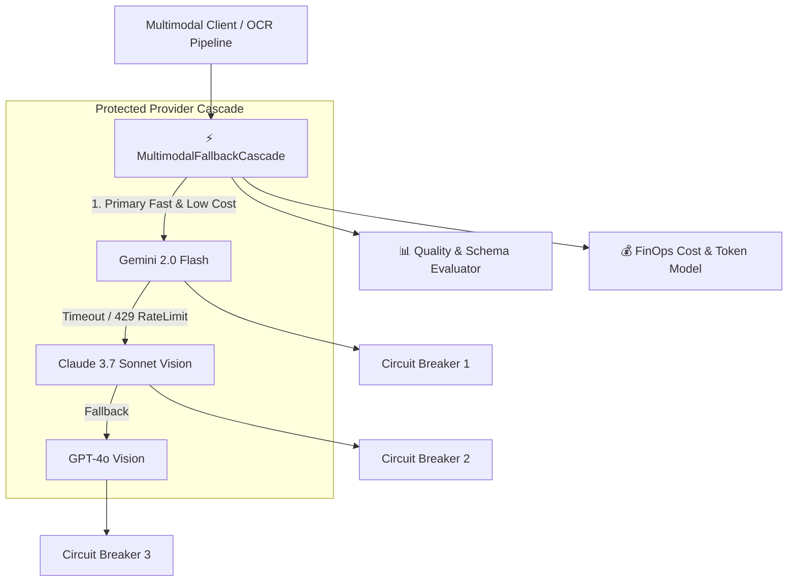

# 👁️ Multimodal Eval Harness

> **Production Multimodal Model Evaluation Framework, Cost Modeling, and Resilient Fallback Cascade.**


---

## 🌟 Overview

Designed to fulfill the applied AI requirements for MVP engagements at **Conrad Labs**:
- Multi-provider model evaluation across vision, image, and video providers.
- Output quality frameworks (schema compliance, OCR/field precision, latency percentiles).
- Production resilience (retry backoff, circuit breakers, automatic 429 failover cascade).
- FinOps cost modeling (per-call USD token calculations and cache efficiency tracking).

---

## 🏗️ Architecture & Fallback Cascade



---

## 🚀 Quickstart & Testing

```bash
# Install dependencies
npm install

# Run unit & integration test suites
npm test

# Run benchmark evaluation runner
npm run benchmark
```
